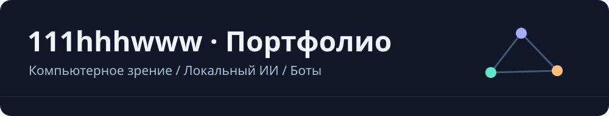

# Проекты Михаила

Пишу на Python и исследую, как применять модели и автоматизацию в приложениях и чат-ботах.

| Проект | Что можно посмотреть |
| --- | --- |
| [Machine Vision](https://github.com/mishaturchin2002-netizen/machine-vision) | Обработка видео с веб-камеры в реальном времени. YOLOv8 для детекции и трекинга, OpenVINO для ускорения на Intel Arc. В README есть архитектура и результаты замеров. |
| [Local AI Chat](https://github.com/mishaturchin2002-netizen/local-ai-chat) | Веб-интерфейс для моделей Ollama с потоковой генерацией, историей диалогов и текстовым контекстом из файлов. |
| [Соседский ресурс](https://github.com/mishaturchin2002-netizen/sosedskie-resurs) | Командный хакатонный прототип для бронирования общего инвентаря. ВКонтакте и MAX использовали общую базу данных. Боты сейчас офлайн. |
